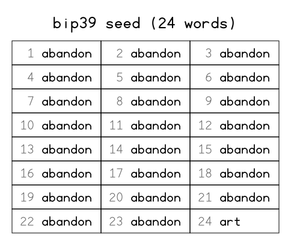
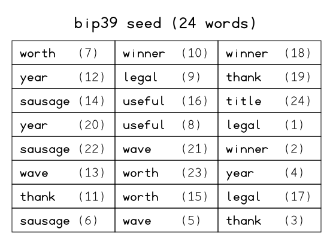
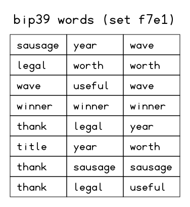
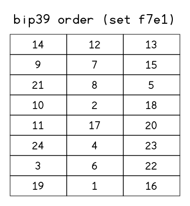

# bip39-dice

Generate a **24-word BIP39 seed from physical six-sided dice**, using every face of every die and as many dice per throw as you like (e.g. 10 at a time).

A single, dependency-free Python script (standard library only) that turns your rolls into a valid mnemonic with **no modulo bias**, computes the checksum word for you, and prints the result as an ASCII grid or as an SVG ready to print. The SVG can optionally be obfuscated: no searchable text, shuffled layout, or split into two sheets.

> [!WARNING]
> **Run this only on an offline (air-gapped) computer**, ideally a live system such as [Tails](https://tails.net/) that keeps nothing on disk.
> Read the code before using it with real funds. It is short on purpose. This software comes with **no warranty**.
> All examples in this README use **public BIP39 test vectors**. Never send funds to them.

---

## Contents

- [Features](#features)
- [How it works](#how-it-works)
- [Requirements](#requirements)
- [Getting the BIP39 wordlist](#getting-the-bip39-wordlist)
- [Usage](#usage)
- [Options](#options)
- [Output examples](#output-examples)
- [Security notes](#security-notes)
- [Verifying the script](#verifying-the-script)
- [References](#references)

---

## Features

- **Uses all six faces of each die.** It never discards entire faces, unlike "roll 1–4 only" methods.
- **Unbiased** conversion through rejection sampling.
- **Enter rolls however you like:**
  - interactively, in batches of any size, with undo and status;
  - all at once on the command line;
  - from a file or through a pipe.
- **Computes the checksum** (word 24) for you, using SHA-256.
- **Checks the wordlist:** refuses to run unless `english.txt` matches the official BIP39 list's SHA-256.
- **Configurable ASCII grid:** any number of columns and rows, read left to right and top to bottom.
- **SVG output** that you can print. The SVG file is:
  - drawn with vector strokes from a built-in font, so it contains **no searchable text**;
  - optionally **shuffled**, with each word tagged with its real position;
  - optionally **split** into a *words* sheet and an *order* sheet;
  - created with `0600` permissions and never overwritten.
- **Standard library only.** No `pip install` needed.

## How it works

A 24-word seed carries 256 bits of entropy plus an 8-bit checksum (24 × 11 = 264 bits).

**Words 1–23.** Each word is an 11-bit number (0–2047). The script reads the dice in **groups of 5** as a base-6 number:

```
value = (d1-1)·1296 + (d2-1)·216 + (d3-1)·36 + (d4-1)·6 + (d5-1)      # 0 … 7775
```

- If `value < 6144` (that is, 3 × 2048), the word index is `value mod 2048`.
- Otherwise the whole group is **discarded** and the script moves on to the next 5 dice.

Every index therefore has exactly the same probability. About 79 % of groups are accepted.

**Word 24.** Three more dice give 3 bits by parity (even = 1, odd = 0, an exact 50/50 split). The remaining 8 bits are the checksum: the first byte of `SHA-256(entropy)`.

**Expected dice.** Around 150 dice on average, roughly 15 throws of 10 dice. The script tells you after every batch the minimum number of dice still needed.

> [!IMPORTANT]
> When you throw several dice at once, **read them in a fixed order**: always left to right, or by colour using dice of different colours. Never sort the values before typing them in, because sorting destroys entropy.

Casino dice (sharp edges, flush-filled pips) are recommended. Drilled pips shift the centre of mass.

## Requirements

- Python **3.8+**
- The official BIP39 English wordlist, saved as `english.txt` next to the script (see below)

## Getting the BIP39 wordlist

Download the list **while you are still online** and copy it to the offline machine together with `bip39_dice.py`:

- **Direct download:** [english.txt](https://raw.githubusercontent.com/bitcoin/bips/master/bip-0039/english.txt)
- **Source repository:** [bitcoin/bips · bip-0039](https://github.com/bitcoin/bips/tree/master/bip-0039)

```bash
curl -O https://raw.githubusercontent.com/bitcoin/bips/master/bip-0039/english.txt
sha256sum english.txt
# 2f5eed53a4727b4bf8880d8f3f199efc90e58503646d9ff8eff3a2ed3b24dbda  english.txt
```

The script checks this hash itself and aborts if it does not match.

## Usage

### Interactive (batches)

```bash
python3 bip39_dice.py
```

```
Enter your rolls in batches (e.g. 10 dice: 3 6 1 2 5 4 4 2 6 1).
Commands: u = undo last batch, s = status, q = quit.

Batch 1 > 3 6 1 2 5 4 4 2 6 1
  Read (10 dice): 3 6 1 2 5 4 4 2 6 1
  Dice entered: 10 | words: 2/23 | rejected groups: 0 | minimum remaining: 108 dice
Batch 2 > 6666612345
  Read (10 dice): 6 6 6 6 6 1 2 3 4 5
  Dice entered: 20 | words: 3/23 | rejected groups: 1 | minimum remaining: 103 dice
Batch 3 > u
  Undid batch: 6666612345
...
```

Spaces, commas and any characters other than `1`–`6` are ignored, so `3 6 1 2 5`, `3,6,1,2,5` and `36125` are all the same input. Made a typo? Type `u` to undo the last batch.

### All at once

```bash
python3 bip39_dice.py --rolls "3612544261 6612345..."
python3 bip39_dice.py --file rolls.txt
cat rolls.txt | python3 bip39_dice.py
```

Leftover dice beyond what is needed are ignored and reported.

### Printing an SVG

```bash
python3 bip39_dice.py --svg seed.svg                     # obfuscated strokes, in order
python3 bip39_dice.py --svg seed.svg --shuffle           # random layout + positions
python3 bip39_dice.py --svg seed.svg --split             # seed-words.svg + seed-order.svg
python3 bip39_dice.py --svg seed.svg --cols 4 --rows 6   # custom grid
```

## Options

| Option | Description |
|---|---|
| `--rolls ROLLS` | All rolls at once (digits 1–6). |
| `--file FILE` | Read rolls from a text file. |
| `--cols N` | Grid columns (default `3`). |
| `--rows N` | Grid rows (default: just enough for 24 words). |
| `--no-numbers` | Hide word numbers in the grid. Not allowed with `--shuffle` or `--split`. |
| `--svg PATH` | Also write the grid as an SVG. Letters are drawn as vector strokes, so the file contains no searchable text. |
| `--svg-text` | Write the SVG with plain `<text>` elements instead (searchable). |
| `--shuffle` | SVG only: place the words in random cells, each followed by its real position, e.g. `zoo (17)`. Uses a CSPRNG. |
| `--split` | SVG only: write `PATH-words.svg` (shuffled words, no positions) and `PATH-order.svg` (positions only, same cells). Both carry the same random pair id. Implies `--shuffle`. |
| `--wordlist PATH` | Path to `english.txt` (default: next to the script). |

The grid is always read **left to right, top to bottom**. If the grid has more cells than words, the extra cells stay empty. A grid with fewer than 24 cells is rejected. The script checks the SVG destination **before** asking for rolls, so you never waste a session of dice throws.

## Output examples

### Terminal (ASCII grid)

The official test vector for all-zero entropy:

```
======== BIP39 SEED (24 words) =========
+------------+------------+------------+
|  1 abandon |  2 abandon |  3 abandon |
+------------+------------+------------+
|  4 abandon |  5 abandon |  6 abandon |
+------------+------------+------------+
|  7 abandon |  8 abandon |  9 abandon |
+------------+------------+------------+
| 10 abandon | 11 abandon | 12 abandon |
+------------+------------+------------+
| 13 abandon | 14 abandon | 15 abandon |
+------------+------------+------------+
| 16 abandon | 17 abandon | 18 abandon |
+------------+------------+------------+
| 19 abandon | 20 abandon | 21 abandon |
+------------+------------+------------+
| 22 abandon | 23 abandon | 24 art     |
+------------+------------+------------+
```

### SVG: in order (`--svg`)



### SVG: shuffled (`--svg --shuffle`)

Read the words by their number in parentheses: (1), (2), (3)…



### SVG: split into two sheets (`--svg --split`)

The cell in row *r*, column *c* of the words sheet goes with the same cell in the order sheet. The two sheets have identical geometry, so you can also lay one over the other against the light. The pair id in the title matches the two sheets.

| Words sheet | Order sheet |
|---|---|
|  |  |

The example images use the public test vectors `0x00…00` (*abandon … art*) and `0x7f…7f` (*legal winner thank year…*).

## Security notes

- **Offline only.** Generate, print and delete on an air-gapped machine. Prefer writing the SVG to RAM (`/dev/shm` or a `tmpfs`), and delete it with `shred -u` after printing.
- **What the stroke-drawn SVG protects against:** `grep`, desktop indexers and malware that scans files for BIP39 phrases.
- **What it does not protect against:**
  - OCR, or anyone who looks at the image;
  - a targeted attacker who knows this script, because each letter always produces the same path.
- **`--shuffle`** only breaks up the phrase as a continuous sequence. The order is printed next to each word.
- **`--split` is a 2-of-2 scheme:**
  - **Losing either sheet makes the seed practically unrecoverable**, because there are about 24!/256 ≈ 2⁷¹ possible orderings to try.
  - The words sheet alone still leaves an attacker with only those ~2⁷¹ candidates. That is hard today, but far below the seed's 256 bits.
- **Always check the seed before funding it.** Restore it in your hardware wallet, and confirm that it is accepted and that the addresses match.
- `english.txt` is intentionally **not** bundled. Download it from the official source and let the script verify its hash.

## Verifying the script

You can confirm the checksum logic against the official test vector without real dice:

```bash
python3 bip39_dice.py --rolls "$(python3 -c "print('11111'*23 + '111')")"
```

Each `11111` group maps to index 0 (`abandon`), and `111` gives 3 zero bits. The expected word 24 is **`art`**, matching the BIP39 test vector for 256 bits of zero entropy.

## References

- [BIP-0039 specification](https://github.com/bitcoin/bips/blob/master/bip-0039.mediawiki)
- [BIP-0039 wordlists (bitcoin/bips)](https://github.com/bitcoin/bips/tree/master/bip-0039)
- [english.txt, direct download](https://raw.githubusercontent.com/bitcoin/bips/master/bip-0039/english.txt)
- [BIP39 test vectors (Trezor `python-mnemonic`)](https://github.com/trezor/python-mnemonic/blob/master/vectors.json)
- [SLIP-0039: Shamir's Secret-Sharing for Mnemonic Codes](https://github.com/satoshilabs/slips/blob/master/slip-0039.md)
